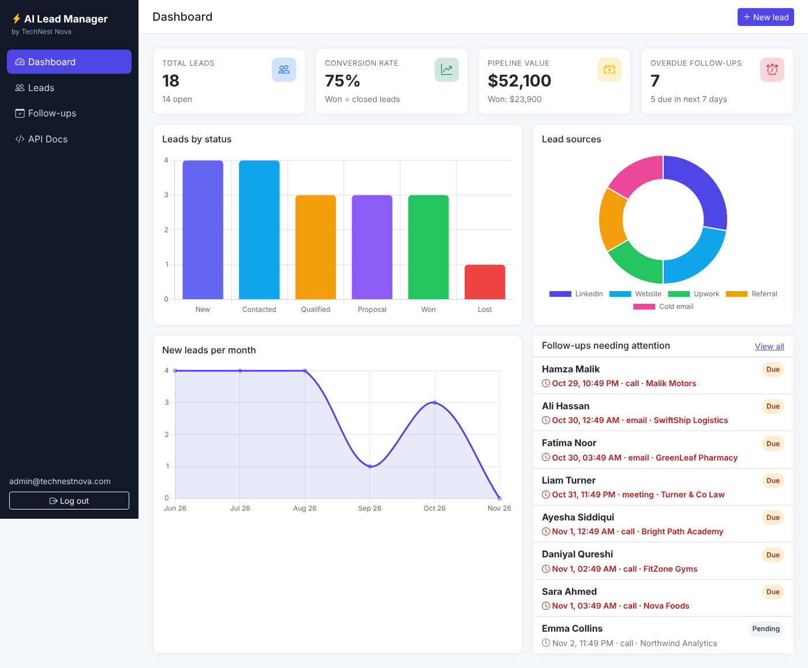
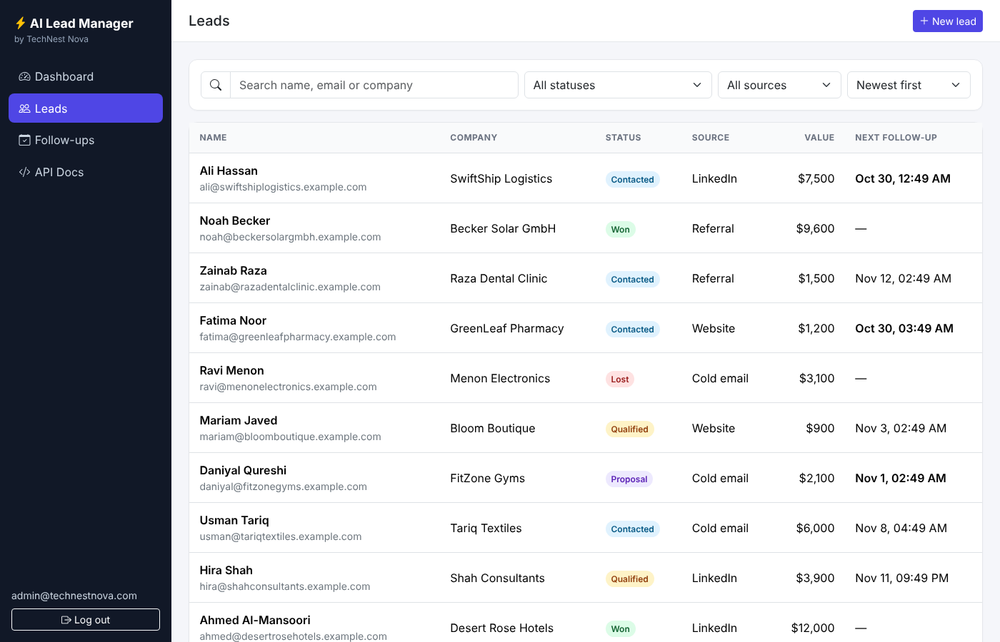
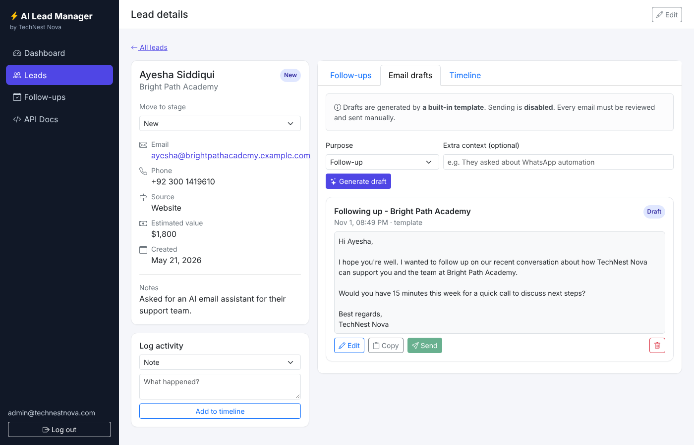
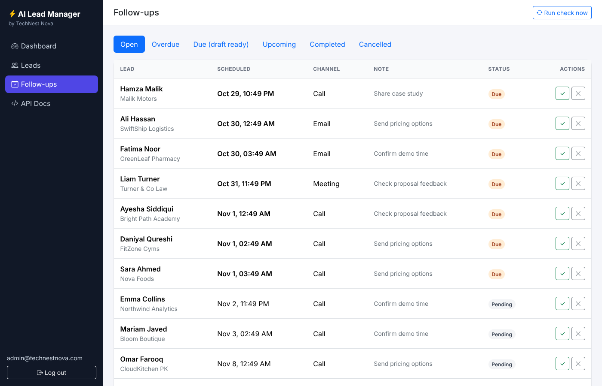

# AI Lead Manager

**Lead management and follow-up automation with AI-written email drafts.**
Built by [TechNest Nova](https://github.com/iabuzrqasim) with FastAPI, SQLAlchemy, Bootstrap 5 and Chart.js.



## Features

| Area | What it does |
|---|---|
| **Lead management** | Create, view, edit and delete leads. Search by name/email/company, filter by status and source, sort and paginate. |
| **Pipeline stages** | `New → Contacted → Qualified → Proposal → Won / Lost`, validated on the server. |
| **Activity timeline** | Every status change, follow-up, email and manual note is logged per lead. |
| **Follow-up automation** | Schedule follow-ups (email, call, WhatsApp, meeting). A background scheduler (APScheduler) marks them **Due** when their time arrives and prepares an email draft. |
| **Duplicate protection** | Each due follow-up is claimed with a conditional `UPDATE ... WHERE status = 'Pending'`, so overlapping runs never process it twice. |
| **Won/Lost exclusion** | Closing a lead cancels its open follow-ups; new ones can't be scheduled. |
| **AI email drafts** | Generates personalised drafts with Claude (Anthropic API) from the lead's details and history. Works without an API key using built-in templates, and falls back safely if the API fails. |
| **Human review** | Drafts are always editable and are **never sent automatically**. |
| **Safe email sending** | Optional SMTP sending, **off by default**. A test-inbox setting redirects every email to one controlled address. |
| **Analytics dashboard** | Total/open leads, conversion rate, pipeline and won value, overdue and upcoming follow-ups, plus charts by status, source and month. All numbers come from the database. |
| **Auth** | JWT login protects every API route; passwords are hashed with PBKDF2-SHA256. |
| **Tests** | 26 Pytest tests covering leads, follow-ups, duplicate processing, analytics, AI fallback and email safety. CI runs them on every push. |

## Screenshots

| Leads | Lead detail & AI drafts | Follow-ups |
|---|---|---|
|  |  |  |

## Tech stack

Python 3.13 · FastAPI · SQLAlchemy 2 · SQLite (PostgreSQL-ready) · Pydantic · APScheduler · PyJWT · httpx · Bootstrap 5 · Chart.js · Pytest · GitHub Actions

## Getting started

```bash
git clone https://github.com/iabuzrqasim/ai-lead-manager.git
cd ai-lead-manager

python -m venv .venv
# Windows (PowerShell):  .\.venv\Scripts\Activate.ps1
# macOS / Linux:         source .venv/bin/activate

pip install -r requirements-dev.txt
cp .env.example .env            # Windows: copy .env.example .env

python -m scripts.seed_demo     # optional: fictional demo data
fastapi dev app/main.py
```

Open **http://127.0.0.1:8000** and sign in with `ADMIN_EMAIL` / `ADMIN_PASSWORD` from `.env`
(defaults: `admin@technestnova.com` / `admin12345`). Change these before deploying.

Interactive API docs: **http://127.0.0.1:8000/docs**

### Run the tests

```bash
pytest
```

## Configuration

All settings live in `.env` (see [`.env.example`](.env.example)).

| Variable | Purpose |
|---|---|
| `DATABASE_URL` | `sqlite:///./leads.db` by default. Use a `postgresql+psycopg://…` URL (and `pip install psycopg[binary]`) for PostgreSQL. |
| `SECRET_KEY` | Signs login tokens. **Must** be a long random string in production. |
| `ADMIN_EMAIL`, `ADMIN_PASSWORD` | First admin account, created on first start. |
| `SCHEDULER_ENABLED`, `SCHEDULER_INTERVAL_SECONDS` | Background follow-up checker. |
| `ANTHROPIC_API_KEY`, `ANTHROPIC_MODEL` | Enables AI drafts. Leave empty to use templates. |
| `EMAIL_SENDING_ENABLED` | `false` by default. Nothing is ever sent unless this is `true`. |
| `SMTP_*` | SMTP server details (e.g. Gmail with an app password). |
| `EMAIL_TEST_INBOX` | When set, every email goes to this address instead of the lead. |

## Project structure

```
app/
├── main.py              # FastAPI app, startup (DB, admin user, scheduler), page routes
├── config.py            # Settings from .env (pydantic-settings)
├── database.py          # Engine, session factory, get_db dependency
├── models.py            # Tables: User, Lead, FollowUp, EmailDraft, Activity
├── schemas.py           # Request validation & response shapes
├── security.py          # Password hashing, JWT, current-user dependency
├── routers/             # API endpoints: auth, leads, followups, emails, analytics
├── services/
│   ├── ai.py            # Claude draft generation + template fallback
│   ├── email_sender.py  # SMTP sending with safety rails
│   ├── followups.py     # Due-follow-up processing (duplicate-safe)
│   └── scheduler.py     # APScheduler background job
└── static/              # HTML pages, CSS and JS (Bootstrap + Chart.js)
scripts/seed_demo.py     # Fictional demo data
tests/                   # Pytest suite
```

## API overview

| Method | Endpoint | Description |
|---|---|---|
| `POST` | `/api/auth/login` | Get an access token |
| `GET` / `POST` | `/api/leads` | List (search, filter, sort, paginate) / create leads |
| `GET` / `PATCH` / `DELETE` | `/api/leads/{id}` | Read / update / delete a lead |
| `GET` / `POST` | `/api/leads/{id}/activities` | Timeline / log an activity |
| `GET` / `POST` | `/api/leads/{id}/follow-ups` | List / schedule follow-ups |
| `GET` | `/api/follow-ups?view=open\|overdue\|due\|upcoming\|completed\|cancelled` | Follow-up queue |
| `POST` | `/api/follow-ups/{id}/complete` · `/cancel` | Close a follow-up |
| `POST` | `/api/follow-ups/run-now` | Run the scheduler job immediately |
| `POST` | `/api/leads/{id}/drafts/generate` | Generate an email draft (AI or template) |
| `PUT` / `DELETE` | `/api/drafts/{id}` | Edit / delete a draft |
| `POST` | `/api/drafts/{id}/send` | Send a reviewed draft (if sending is enabled) |
| `GET` | `/api/analytics/dashboard` | Dashboard metrics |

## Production notes

- Run with **one worker** (`fastapi run app/main.py`), or set `SCHEDULER_ENABLED=false` on all but one instance. Duplicate protection still holds if two run, but one scheduler is cleaner.
- Set a strong `SECRET_KEY` and admin password, and serve over HTTPS.
- For schema changes on an existing database, add [Alembic](https://alembic.sqlalchemy.org/) migrations.
- All demo data is fictional and uses `example.com` addresses.

## License

MIT © TechNest Nova
